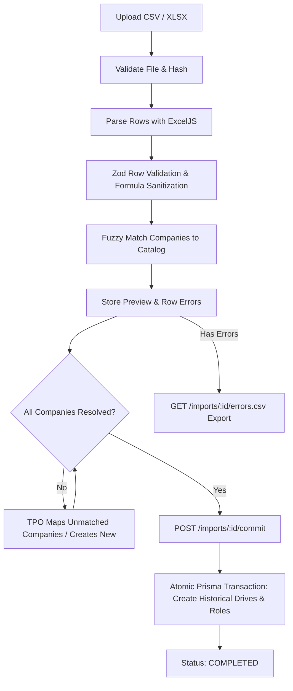

# Historical Placement Data Import Pipeline

This skill guides the implementation, operation, and maintenance of historical placement data imports (both `HISTORICAL_DRIVES` and `APPLICATION_RESULTS`) in CampusEdge.

## 1. Architecture & Safeguards

### File Constraints

- Formats accepted: `.csv`, `.xlsx` (processed in-memory via `ExcelJS`).
- Maximum file size: `5 MB`.
- Maximum row count: `2,000` rows per import job.
- File integrity: SHA-256 hash computed on upload to prevent duplicate processing of the same file.

### Spreadsheet Formula Injection Defense

To protect administrators and analysts exporting data back into spreadsheet applications (Excel, Google Sheets, LibreOffice Calc):

- Any cell value starting with `=`, `+`, `-`, or `@` must have a leading single-quote `'` prepended before export or storage, neutralizing executable formula injection (`CSV/Formula Injection` CWE-1236).
- All string values must be trimmed and normalized.

### Tenant Isolation

- Every import job is strictly bound to `collegeId` with composite keys `(id, collegeId)`.
- Associated error rows and generated drives/applications are strictly scoped to the same tenant.

---

## 2. Supported Import Types & Schema

### A. HISTORICAL_DRIVES

Imports completed past drives with macro statistics.

| Column              | Type / Constraint     | Description                                                            |
| ------------------- | --------------------- | ---------------------------------------------------------------------- |
| `company_name`      | String (Required)     | Name of recruiter. Matched against global catalog.                     |
| `season_label`      | String (Required)     | Academic year (e.g. `2024-25`). Auto-linked or created.                |
| `title`             | String (Required)     | Drive title (e.g. `Infosys Campus Drive 2024`).                        |
| `drive_date`        | YYYY-MM-DD (Optional) | Date when company visited.                                             |
| `category`          | Enum                  | `REGULAR`, `DREAM`, `SUPER_DREAM`. Defaults to `REGULAR`.              |
| `role_title`        | String (Required)     | Role designation (e.g. `Systems Engineer`).                            |
| `job_type`          | Enum                  | `FULL_TIME`, `INTERNSHIP`, `INTERN_PLUS_FTE`. Defaults to `FULL_TIME`. |
| `ctc_min_lpa`       | Decimal >= 0          | Minimum package in LPA. Must be <= `ctc_max_lpa`.                      |
| `ctc_max_lpa`       | Decimal >= 0          | Maximum package in LPA.                                                |
| `registered_count`  | Int >= 0              | Total students registered.                                             |
| `shortlisted_count` | Int >= 0              | Total students shortlisted.                                            |
| `selected_count`    | Int >= 0              | Total offers made. Must be <= `registered_count`.                      |

### B. APPLICATION_RESULTS

Imports individual student outcomes for existing drives.

| Column                                        | Type / Constraint       | Description                                         |
| --------------------------------------------- | ----------------------- | --------------------------------------------------- |
| `drive_id` or `company_name` + `season_label` | UUID or Strings         | Unique identification of the drive.                 |
| `roll_number` or `email`                      | String                  | Identifies student profile in this college.         |
| `status`                                      | Enum                    | `SELECTED`, `REJECTED`, `SHORTLISTED`, `WITHDRAWN`. |
| `offered_ctc_lpa`                             | Decimal >= 0 (Optional) | Final offered compensation in LPA.                  |

---

## 3. Execution Pipeline Lifecycle

## 4. Error Handling & Reporting

- Every invalid row records:
  - `rowNumber`: 1-based index matching the original spreadsheet.
  - `column`: Field that triggered the validation failure.
  - `message`: Specific description (e.g. `ctc_min_lpa (12.0) cannot exceed ctc_max_lpa (10.0)`).
- TPO can download `errors.csv` at any time to fix issues in their original spreadsheet and re-upload.
