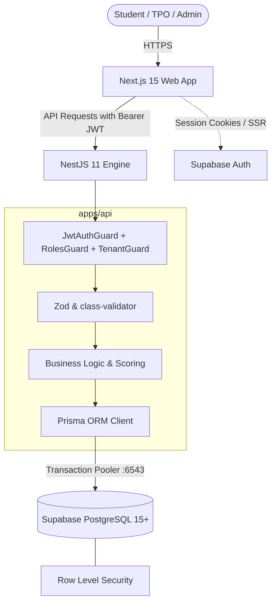

# CampusEdge — College Placement Intelligence Engine

CampusEdge is an AI-assisted, college-specific placement preparation and institutional intelligence SaaS designed for engineering colleges across India.

---

## Architecture Diagram



---

## Tech Stack

- **Monorepo**: Turborepo + pnpm workspaces
- **Frontend (`apps/web`)**: Next.js 15 (App Router), TypeScript, Tailwind CSS, shadcn/ui, `@supabase/ssr`
- **Backend (`apps/api`)**: NestJS 11, TypeScript, Passport JWT, `@nestjs/throttler`, Pino, Swagger
- **Database & Auth (`packages/database`)**: PostgreSQL 15+ hosted on Supabase, Prisma ORM, Row Level Security (RLS)
- **Shared Contracts (`packages/shared`)**: Shared Zod schemas, TypeScript types, DTOs, enums
- **Testing**: Vitest (frontend and shared packages), Jest (NestJS backend)

---

## Windows Prerequisites

- **Node.js**: `>= 22` (`node -v`)
- **pnpm**: `>= 10` (`pnpm -v`)
- **Git**: Installed and available in PATH
- **Docker Desktop**: With WSL 2 backend or Virtual Machine Platform enabled (required for local Supabase Docker stack)

---

## Step-by-Step Local Setup

### 1. Clone & Install Dependencies

```powershell
git clone <repository-url>
cd CampusEdge
pnpm install
```

### 2. Configure Environment Files

Copy example environment templates to their local equivalents:

```powershell
Copy-Item apps/web/.env.example apps/web/.env.local
Copy-Item apps/api/.env.example apps/api/.env.local
```

Fill in the local credentials:

- `apps/web/.env.local`: `NEXT_PUBLIC_SUPABASE_URL`, `NEXT_PUBLIC_SUPABASE_PUBLISHABLE_KEY`, `NEXT_PUBLIC_API_URL`
- `apps/api/.env.local`: `DATABASE_URL`, `DIRECT_URL`, `SUPABASE_URL`, etc.

### 3. Initialize & Start Local Supabase Stack

```powershell
pnpm supabase:start
```

### 4. Zero-Dashboard-SQL Database Setup

A new developer sets up the database entirely via the terminal:

```powershell
# 1. Run migrations against the database
pnpm db:migrate:dev

# 2. Seed development fixtures (demo college and placement admin)
pnpm db:seed

# 3. Verify Row Level Security is active on 100% of public tables
pnpm db:verify-rls
```

### 5. Launch the Development Environment

```powershell
pnpm dev
```

- Web Application: [http://localhost:3000](http://localhost:3000)
- System Status: [http://localhost:3000/status](http://localhost:3000/status)
- API Docs (Swagger): [http://localhost:4000/docs](http://localhost:4000/docs)
- Health Heartbeat: [http://localhost:4000/api/v1/health](http://localhost:4000/api/v1/health)

---

## Environment Variables Reference

| Variable                               | Scope     | Description                                                    |
| :------------------------------------- | :-------- | :------------------------------------------------------------- |
| `NEXT_PUBLIC_SUPABASE_URL`             | Web & API | Public Supabase project endpoint                               |
| `NEXT_PUBLIC_SUPABASE_PUBLISHABLE_KEY` | Web       | Client-side publishable key                                    |
| `NEXT_PUBLIC_API_URL`                  | Web       | Backend API base URL (`http://localhost:4000`)                 |
| `DATABASE_URL`                         | API       | PostgreSQL transaction pooler URL (port 6543)                  |
| `DIRECT_URL`                           | API & DB  | Direct PostgreSQL connection string (port 5432) for migrations |
| `SUPABASE_SECRET_KEY`                  | API       | Service role secret key (never exposed to frontend)            |
| `SUPABASE_JWT_SECRET`                  | API       | JWT secret (if using HS256 HMAC verification)                  |
| `WEB_ORIGIN`                           | API       | CORS allowed origin (`http://localhost:3000`)                  |
| `NODE_ENV`                             | API & Web | Environment mode (`development`, `production`, `test`)         |

---

## Database Workflow (Local & Remote)

1. **Modify Schema**: Update `packages/database/prisma/schema.prisma`.
2. **Draft Migration**:
   ```powershell
   pnpm --filter @campusedge/database exec prisma migrate dev --create-only --name <feature_name>
   ```
3. **Add Custom SQL**: Open the created migration file and append `ALTER TABLE ... ENABLE ROW LEVEL SECURITY;`, policies, and triggers.
4. **Apply Locally**: `pnpm db:migrate:dev`
5. **Verify Security**: `pnpm db:verify-rls`
6. **Deploy to Remote**:
   ```powershell
   pnpm db:migrate:deploy:remote
   pnpm db:verify-rls:remote
   ```

---

## Root Scripts Reference

```powershell
pnpm dev                     # Run web and api concurrently in development mode
pnpm build                   # Build all workspace applications and libraries
pnpm lint                    # Run ESLint and Prettier checks across monorepo
pnpm typecheck               # Run strict TypeScript checks across all packages
pnpm test                    # Run all unit test suites (Jest + Vitest)
pnpm db:generate             # Re-generate Prisma Client from schema
pnpm db:migrate:deploy:remote # Apply Prisma migrations to remote dev database
pnpm db:verify-rls:remote    # Verify RLS enabled on all 10 public tables
pnpm db:test-rls:remote      # Run 6 automated database RLS security tests
pnpm db:seed:dev-users       # Seed confirmed Supabase auth accounts for demo testing
pnpm admin:create-super-admin --email <email> # Provision a platform super admin
pnpm --filter @campusedge/web test:e2e        # Run Playwright E2E browser tests
```

---

## Phase 1 Seeded Demo Accounts

The following confirmed demo identities are pre-seeded in the development database for end-to-end evaluation:

| Role                | Email                            | Affiliated College           | Initial Route               |
| :------------------ | :------------------------------- | :--------------------------- | :-------------------------- |
| **Student**         | `student.demo@apex.edu`          | Apex Institute of Technology | `/student/dashboard`        |
| **Placement Admin** | `placement.admin@apex.edu`       | Apex Institute of Technology | `/placement-cell/dashboard` |
| **Super Admin**     | `superadmin@campusedge.internal` | Platform Operator (Bypass)   | `/admin/colleges`           |

_Password: Defined in local `.env` files via `SEED_DEMO_PASSWORD`._

---

## Monorepo Folder Structure

```
CampusEdge/
├── .agent/                  # Architecture rules, skills, and execution workflows
├── apps/
│   ├── web/                 # Next.js 15 App Router frontend (Auth, Stepper, Shells, Legal)
│   └── api/                 # NestJS 11 backend API (Admin, Colleges, Onboarding, Students, Audit)
├── packages/
│   ├── database/            # Prisma schema, migrations, seed, RLS audit and security test scripts
│   ├── shared/              # Shared Zod schemas, types, DTOs, enums, constants
│   └── config/              # Shared tsconfig, eslint, prettier configurations
├── docker/                  # Multi-stage production Dockerfiles
├── .github/workflows/       # GitHub Actions CI workflow (with Postgres auth stub)
├── docs/                    # Architecture records, ADRs (ADR 0001, ADR 0002)
├── ROADMAP.md               # Product roadmap and phase tracking (Phases 0 & 1 Complete)
└── README.md                # Project documentation
```

---

## Security & Compliance Architecture

- **Tenant Scoping**: All institutional data is strictly partitioned by `college_id`.
- **Zero Client Metadata Trust**: Role and College ID can NEVER be self-assigned via client-side metadata.
- **Data API Lockdown**: All PostgREST direct table grants revoked from `anon` and `authenticated`.
- **Append-Only Immutability**: PostgreSQL triggers abort any `UPDATE` or `DELETE` attempt on `audit_logs` and `consent_records`.
- **DPDP Act 2023**: Comprehensive statutory consent capture (Terms, Privacy, Placement Processing) and data subject request endpoints (`EXPORT`, `DELETE`).
