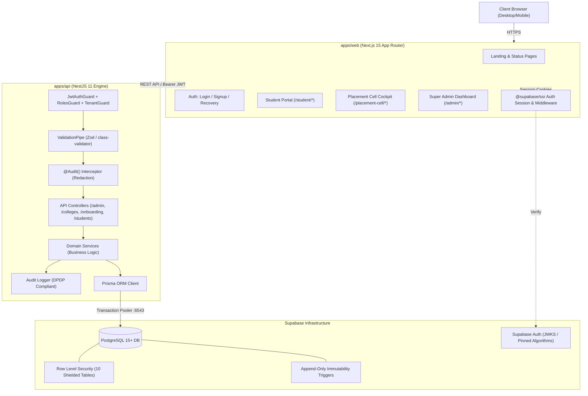

# CampusEdge System Architecture

## Architecture Diagram

## Multi-Tenant Security & Defense in Depth

1. **Authoritative Identity (No Metadata Trust)**:
   - Client signup metadata (`raw_user_meta_data`) is discarded by database trigger `handle_new_user()`.
   - Every signup defaults strictly to role `STUDENT` with status `ONBOARDING` and `college_id = NULL`.
   - Privilege elevation to `COLLEGE_ADMIN` requires transactional acceptance of an institutional invitation issued by `SUPER_ADMIN`.
   - `SUPER_ADMIN` can only be provisioned via terminal CLI (`pnpm admin:create-super-admin`).

2. **Data API Lockdown**:
   - All direct table, sequence, and routine grants are revoked from `anon` and `authenticated` roles (`REVOKE ALL ON ALL TABLES IN SCHEMA public FROM anon, authenticated`).
   - All client queries must traverse the NestJS API application layer.

3. **PostgreSQL RLS & Helper Functions**:
   - `auth_user_role()` and `auth_college_id()` are marked `SECURITY DEFINER SET search_path = ''` to prevent search path hijacking and infinite policy recursion.
   - Row Level Security policies enforce student isolation, college tenant partitioning, and super admin bypass across all 10 public tables.

4. **Trigger-Enforced Immutability (DPDP 2023)**:
   - `audit_logs` and `consent_records` tables feature PostgreSQL triggers (`trg_prevent_audit_log_mutation`, `trg_prevent_consent_mutation`) that abort any `UPDATE` or `DELETE` attempt.
   - Audit logging automatically redacts passwords, tokens, cookies, and bearer credentials.

5. **Token Verification & Pinned Algorithms**:
   - `JwtStrategy` explicitly pins verification algorithms (`HS256` or `RS256`/`ES256`).
   - Validates `iss` (Supabase URL) and `aud` (`authenticated`).
   - Queries `user_profiles` with a 30s in-memory cache to detect suspended/deactivated accounts in real time.
