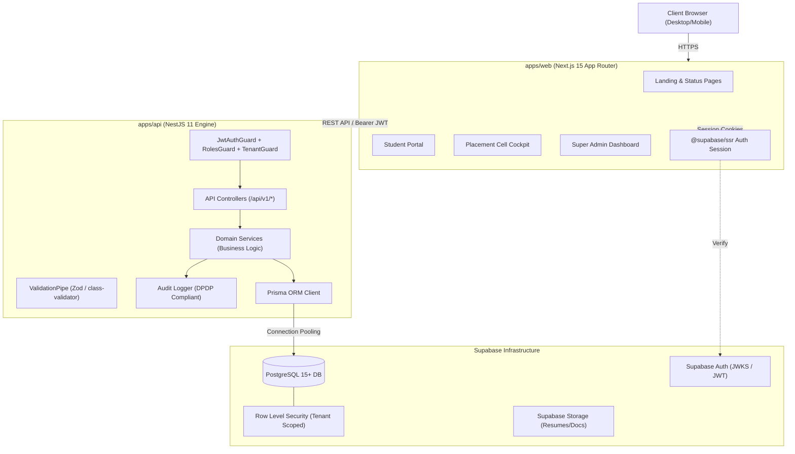

# CampusEdge System Architecture

## Architecture Diagram

## Multi-Tenant Security Model

- **College Tenant Scoping**: Every institutional entity is scoped by `college_id`.
- **Primary Enforcement**: NestJS `TenantGuard` verifies that requests belong to the authenticated user's institution.
- **Secondary Defense**: PostgreSQL Row Level Security (RLS) ensures database-level row segregation even if queries are executed directly.
